# Global Weather Trend Forecasting - Advanced Analysis

## PM Accelerator Mission

> By making industry-leading tools and education available to individuals from all backgrounds, we level the playing field for future PM leaders. This is the PM Accelerator motto, as we grant aspiring and experienced PMs what they need most – Access. We introduce you to industry leaders, surround you with the right PM ecosystem, and discover the new world of AI product management skills.

## Overview

- Dataset: Global Weather Repository (168,785 rows after cleaning, 268 locations, 2024-05-16 to 2026-10-02)
- Scope: data cleaning, EDA, anomaly detection, multi-model forecasting with an ensemble, climate / air-quality / feature-importance / spatial / geographic analyses.

## Key insights (computed from the data)

1. Observation time (UTC) drifted gradually from about 14:00 in 2024-05 to about 6:00 in 2026-10. Temperature depends strongly on time of day, so the forecasting target, seasonal/climate, country and map analyses use only rows recorded within +/-3 h of 06:00 UTC from 2025-06 onward (56% of all rows).
2. Strongest linear correlates of temperature (excluding feels-like): uv_index (+0.48), pressure_mb (-0.44), latitude (-0.35).
3. Global mean temperature is 21.5 C; the wettest month on average is 9 (0.16 mm) and the driest is 2 (0.11 mm). 67% of observations record zero precipitation.
4. 1.0% of records are multivariate anomalies; they cluster in Indonesia (310 records). Their most common conditions: Sunny (34%), Partly cloudy (16%), Mist (16%).
5. Best test model: **ensemble_top3** (RMSE 0.338 C, MAE 0.278 C). Best single model: sarimax (RMSE 0.345 C); the ensemble improves RMSE by 2.1%.
6. Seasonal cycles dominate: Mongolia has the largest annual temperature swing (42.6 C). With only 17 months of consistent-time data, climate TRENDS cannot be estimated, so none are reported.
7. PM2.5 is most associated with **humidity** (Spearman -0.26) among weather variables; median PM2.5 is 9.6 on rainy records vs 15.3 on dry ones. Most polluted country by median PM2.5: Saudi Arabia (100.1).
8. Top features for temperature by consensus rank: latitude, uv_index, pressure_mb (RF hold-out R2 0.93).
9. Mean temperature falls with distance from the equator (corr with |latitude| = -0.72).
10. Hottest country on average: Qatar (33.1 C); coldest: Iceland (5.6 C); highest mean precipitation: Sierra Leone (0.59 mm). Northern and southern hemisphere seasonal cycles are in opposite phase.

## 1. Data cleaning & preprocessing

- Loaded **168,786** rows, kept **168,785** after parsing `last_updated` and removing duplicates.

- Dropped redundant unit-duplicate columns (Fahrenheit, mph, inches, miles, epoch).

- No missing values found.

- Numeric gaps filled with the **per-location median** (global median as fallback); categorical gaps with `Unknown`.

**Outlier counts (1.5xIQR rule), top columns:**

| index | outliers(IQR 1.5) | share_% |
|---|---|---|
| visibility_km | 34471 | 20.42 |
| precip_mm | 33520 | 19.86 |
| air_quality_Sulphur_dioxide | 23397 | 13.86 |
| air_quality_PM10 | 17962 | 10.64 |
| air_quality_Nitrogen_dioxide | 17291 | 10.24 |
| air_quality_Carbon_Monoxide | 14881 | 8.82 |
| air_quality_gb-defra-index | 14350 | 8.50 |
| air_quality_PM2.5 | 14198 | 8.41 |
| longitude | 12981 | 7.69 |
| air_quality_us-epa-index | 10321 | 6.11 |
| air_quality_Ozone | 5205 | 3.08 |
| pressure_mb | 4534 | 2.69 |

- Outliers are **kept in the raw frame** (needed for anomaly detection) and **winsorised at the 1st/99th percentile** in a second frame used for correlations and ML.

- Features standardised (z-score) for ML: mean ~ 4.9e-15, std ~ 1.00.

## 1b. Data quality - time of day of the observations

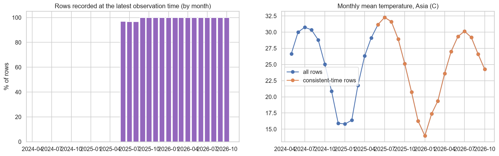
*Observation time of day drifted during collection*

> **Insight:** Observation time (UTC) drifted gradually from about 14:00 in 2024-05 to about 6:00 in 2026-10. Temperature depends strongly on time of day, so the forecasting target, seasonal/climate, country and map analyses use only rows recorded within +/-3 h of 06:00 UTC from 2025-06 onward (56% of all rows).

- **Caveat:** every location is observed at the same UTC time, i.e. at a different LOCAL time of day (e.g. 06:00 UTC is early afternoon in South-East Asia but night-time in the Americas). Country, continent and map comparisons therefore mix climate with local time of day.

## 2. Exploratory data analysis

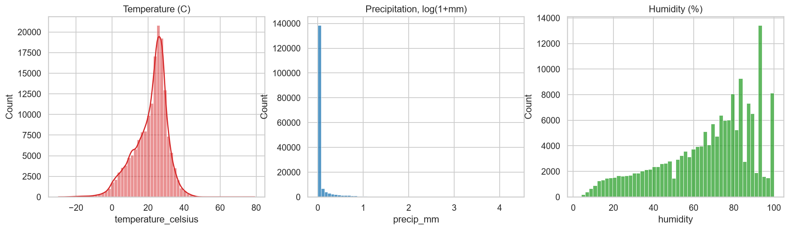
*Distributions of temperature, precipitation and humidity*

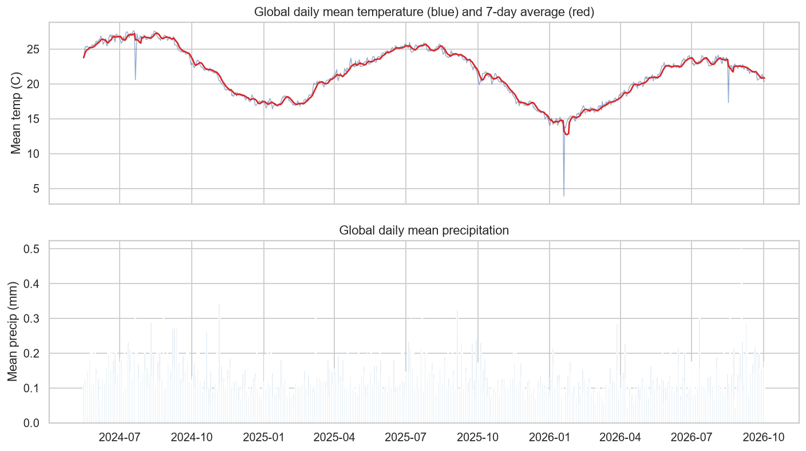
*Global temperature and precipitation over time*

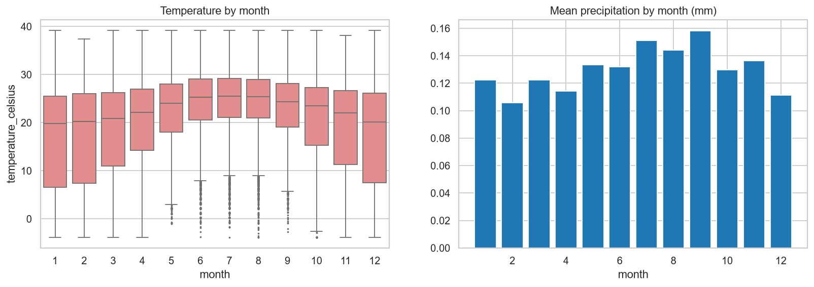
*Seasonal patterns of temperature and precipitation*

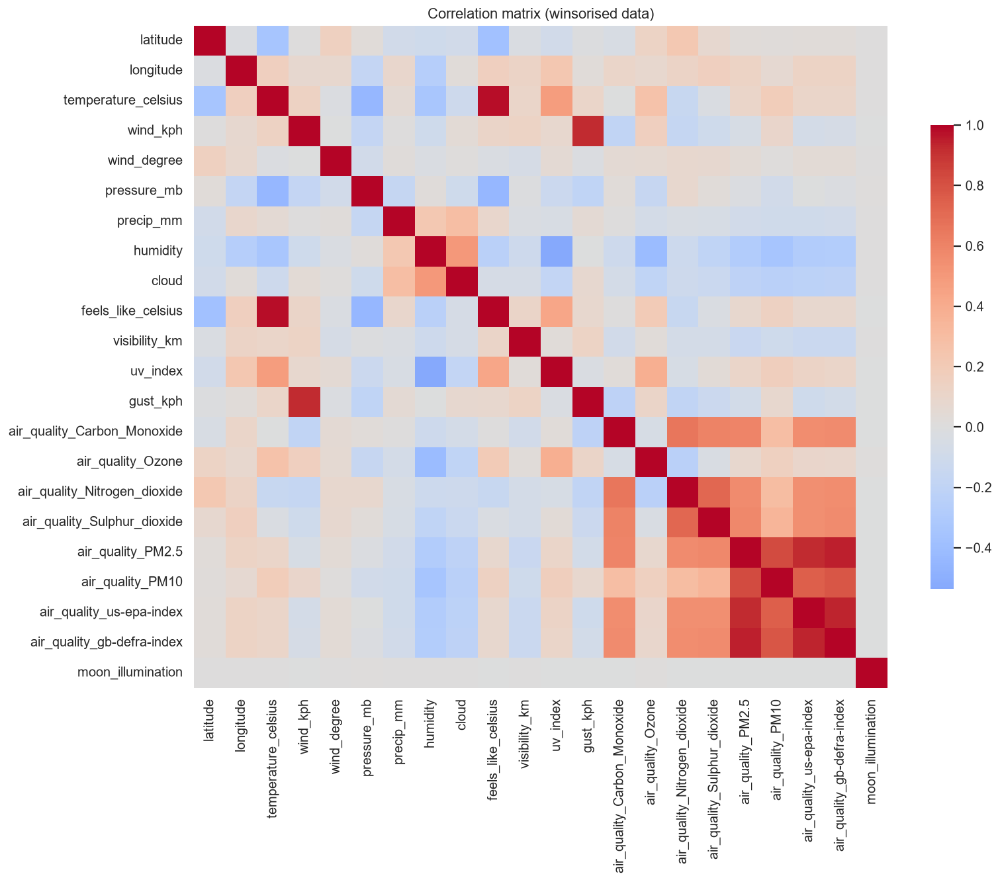
*Correlation matrix of numeric features*

> **Insight:** Strongest linear correlates of temperature (excluding feels-like): uv_index (+0.48), pressure_mb (-0.44), latitude (-0.35).

> **Insight:** Global mean temperature is 21.5 C; the wettest month on average is 9 (0.16 mm) and the driest is 2 (0.11 mm). 67% of observations record zero precipitation.

## 3. Advanced EDA - anomaly detection

- **Isolation Forest** (multivariate, 1% contamination): **1,688** anomalous records.

- **Local z-score** (temperature vs. same location & month, |z|>3): **524** records.

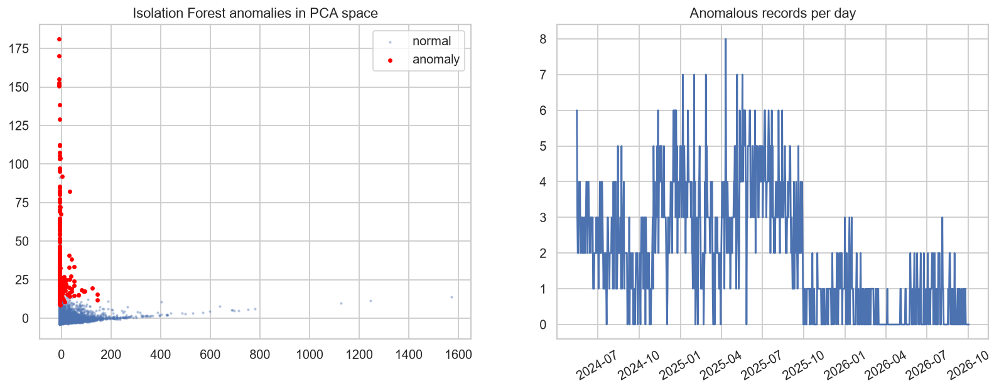
*Anomaly overview (PCA projection and daily counts)*

**Median weather conditions: anomalies vs. normal records**

| index | anomalies_median | normal_median |
|---|---|---|
| temperature_celsius | 26.200 | 23.600 |
| humidity | 49.000 | 73.000 |
| wind_kph | 10.100 | 10.400 |
| pressure_mb | 1012.000 | 1014.000 |
| precip_mm | 0.000 | 0.000 |
| cloud | 0.000 | 31.000 |
| visibility_km | 10.000 | 10.000 |
| uv_index | 2.400 | 1.400 |

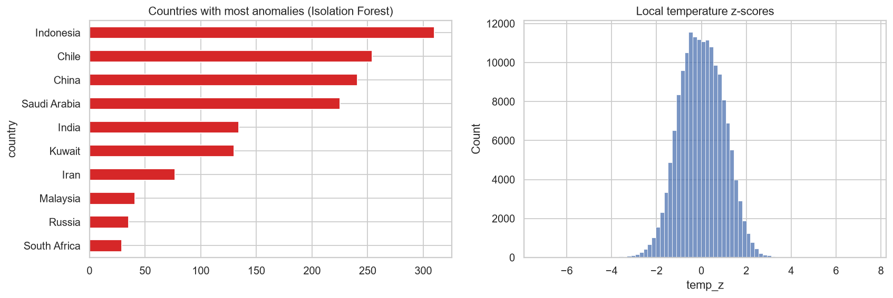
*Where anomalies occur and local z-score distribution*

- The 50 most anomalous records are saved to `top_anomalies.csv`.

> **Insight:** 1.0% of records are multivariate anomalies; they cluster in Indonesia (310 records). Their most common conditions: Sunny (34%), Partly cloudy (16%), Mist (16%).

## 4. Forecasting with multiple models and an ensemble

- Only rows observed at a consistent time of day are used (see section 1b).

- Stable panel: the target averages **185 locations** observed on >=90% of days; 2 incomplete day(s) were dropped. This avoids artificial jumps caused by cities being added to the repository over time.

- Target: **global daily mean temperature** (mean over the stable panel, `last_updated` as time index), 489 days (2025-06-01 to 2026-10-02).

- Split: last **14 days = test**, the 14 days before that = **validation** (used only to weight the ensemble); all models are refit on train+validation before predicting the test window.

**Test-set metrics (lower is better, except R2):**

| index | MAE | RMSE | MAPE | sMAPE | R2 |
|---|---|---|---|---|---|
| ensemble_top3 | 0.278 | 0.338 | 1.323 | 1.316 | 0.458 |
| sarimax | 0.270 | 0.345 | 1.280 | 1.282 | 0.434 |
| ensemble_weighted | 0.288 | 0.360 | 1.370 | 1.361 | 0.385 |
| harmonic_ridge | 0.297 | 0.375 | 1.392 | 1.403 | 0.333 |
| ensemble_average | 0.329 | 0.401 | 1.572 | 1.558 | 0.238 |
| gradient_boosting | 0.420 | 0.521 | 2.003 | 2.000 | -0.289 |
| random_forest | 0.562 | 0.651 | 2.696 | 2.648 | -1.011 |
| ets_damped | 0.720 | 0.831 | 3.458 | 3.379 | -2.280 |
| seasonal_naive_7 | 0.813 | 0.905 | 3.897 | 3.805 | -2.886 |
| naive | 0.810 | 0.929 | 3.890 | 3.793 | -3.096 |

**Ensemble weights (inverse validation RMSE):** harmonic_ridge=0.18, sarimax=0.40, ets_damped=0.13, random_forest=0.15, gradient_boosting=0.14. `ensemble_top3` averages: sarimax, harmonic_ridge, random_forest.

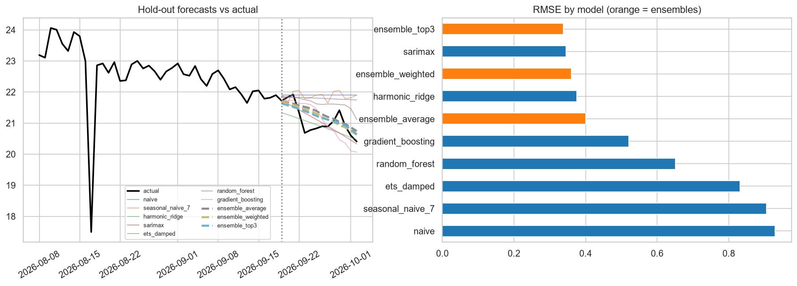
*Model comparison on the hold-out window*

> **Insight:** Best test model: **ensemble_top3** (RMSE 0.338 C, MAE 0.278 C). Best single model: sarimax (RMSE 0.345 C); the ensemble improves RMSE by 2.1%.

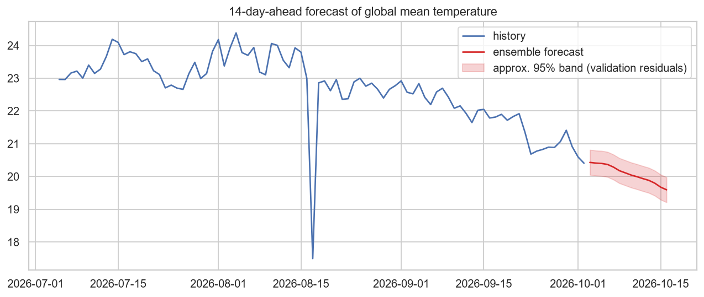
*Out-of-sample forecast beyond the last observed date*

## 5. Climate analysis - patterns by region

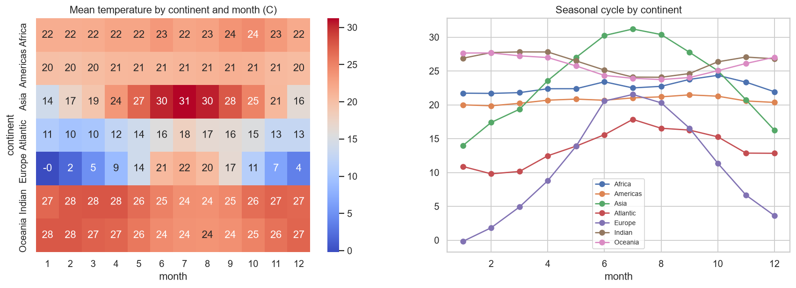
*Monthly climatology by continent*

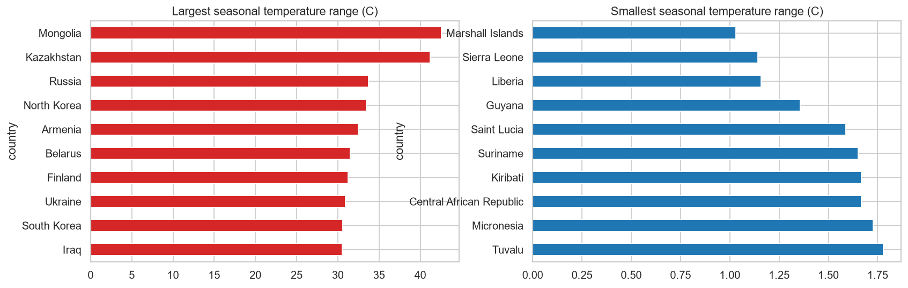
*Seasonal range of monthly mean temperature by country*

- **Long-term trends cannot be estimated:** the consistent-time data covers only 17 months (less than two full years), so there is no repeated calendar month to compare against. Climate analysis is therefore limited to the seasonal cycle and regional differences above.

> **Insight:** Seasonal cycles dominate: Mongolia has the largest annual temperature swing (42.6 C). With only 17 months of consistent-time data, climate TRENDS cannot be estimated, so none are reported.

## 6. Environmental impact - air quality vs weather

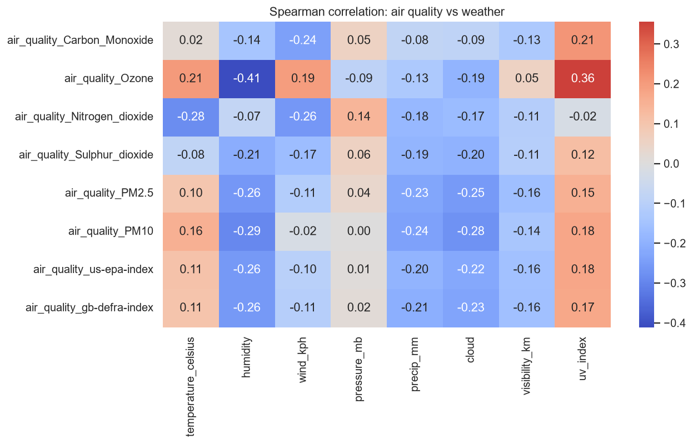
*Air-quality pollutants vs weather variables*

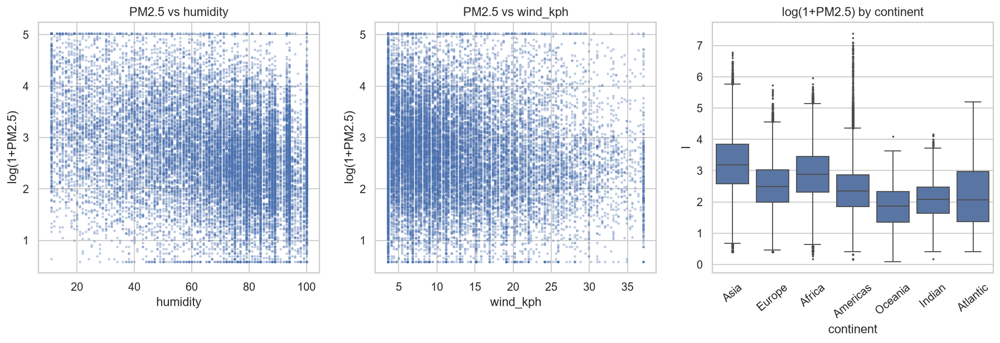
*PM2.5 relationships and continental distribution*

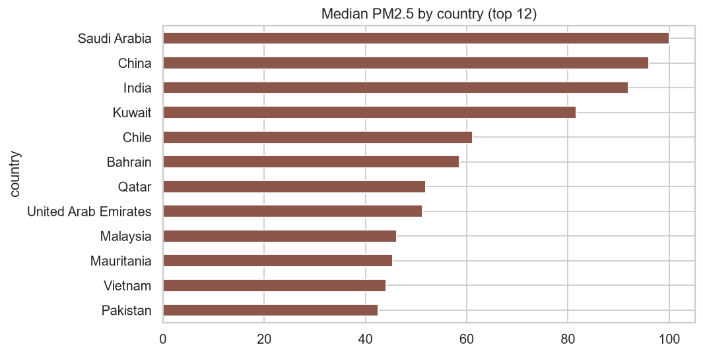
*Most polluted countries by median PM2.5*

> **Insight:** PM2.5 is most associated with **humidity** (Spearman -0.26) among weather variables; median PM2.5 is 9.6 on rainy records vs 15.3 on dry ones. Most polluted country by median PM2.5: Saudi Arabia (100.1).

## 7. Feature importance (target: temperature)

Random-forest hold-out R2 = **0.933** (random split; location identity is partly encoded by latitude/longitude).

| index | pearson | spearman | mutual_info | rf_impurity | rf_permutation | consensus_rank |
|---|---|---|---|---|---|---|
| latitude | 0.742 | 0.743 | 0.864 | 1.000 | 1.000 | 2.000 |
| uv_index | 1.000 | 0.882 | 0.387 | 0.595 | 0.438 | 2.200 |
| pressure_mb | 0.917 | 1.000 | 0.363 | 0.338 | 0.259 | 3.000 |
| humidity | 0.698 | 0.653 | 1.000 | 0.096 | 0.093 | 4.200 |
| longitude | 0.336 | 0.514 | 0.756 | 0.114 | 0.094 | 5.600 |
| hour | 0.415 | 0.584 | 0.219 | 0.017 | 0.010 | 7.400 |
| air_quality_Nitrogen_dioxide | 0.310 | 0.578 | 0.211 | 0.021 | 0.009 | 8.200 |
| air_quality_Ozone | 0.547 | 0.414 | 0.112 | 0.020 | 0.006 | 9.400 |
| air_quality_PM10 | 0.394 | 0.324 | 0.063 | 0.022 | 0.007 | 10.200 |
| month | 0.168 | 0.121 | 0.148 | 0.310 | 0.329 | 10.400 |

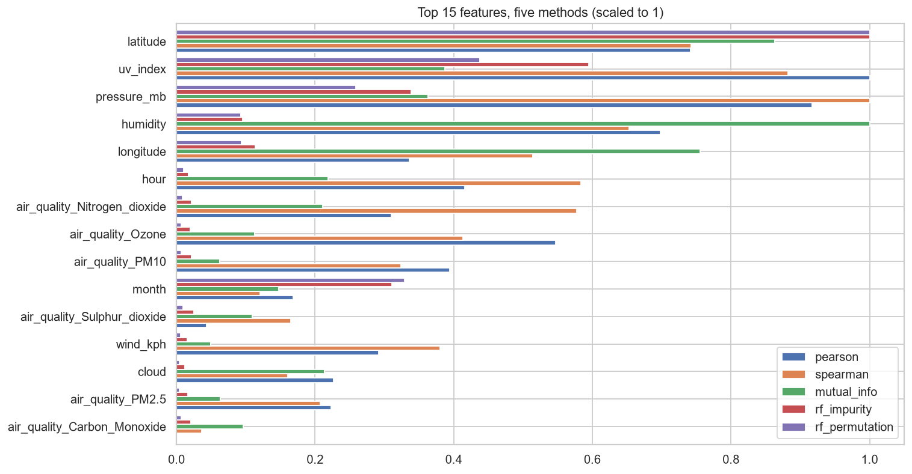
*Feature importance by method*

> **Insight:** Top features for temperature by consensus rank: latitude, uv_index, pressure_mb (RF hold-out R2 0.93).

## 8. Spatial analysis

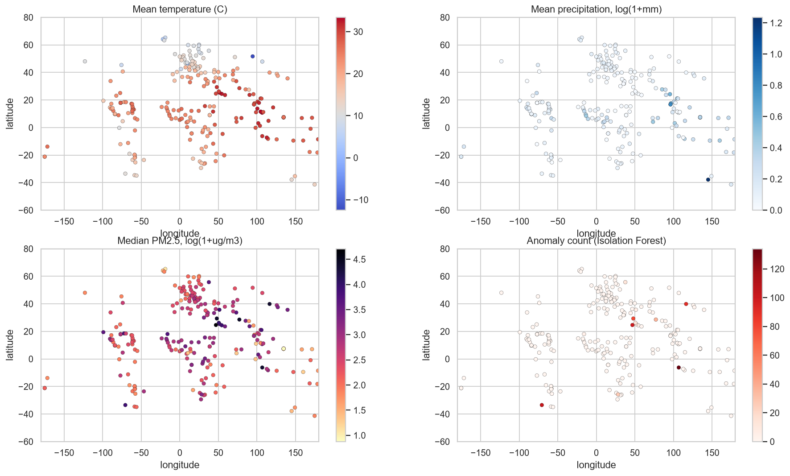
*Geographic distribution of temperature, precipitation, PM2.5 and anomalies (lon/lat scatter)*

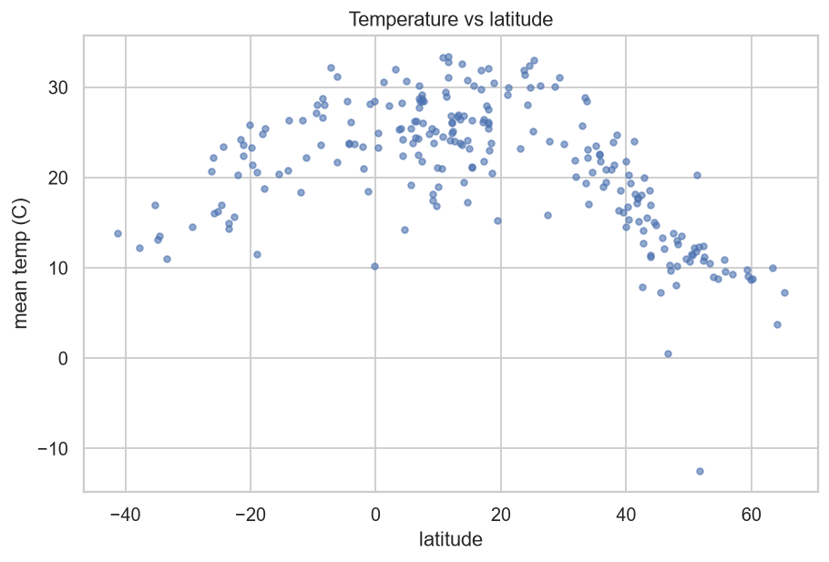
*Mean temperature versus latitude*

> **Insight:** Mean temperature falls with distance from the equator (corr with |latitude| = -0.72).

## 9. Geographical patterns - countries and continents

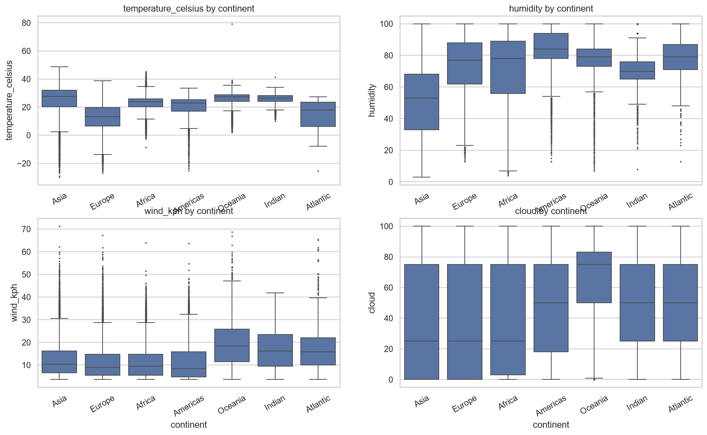
*Weather variable distributions by continent*

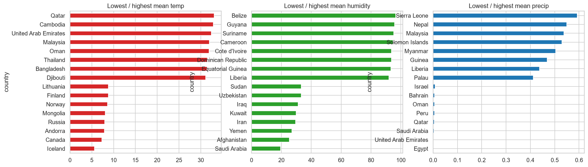
*Country extremes in temperature, humidity and precipitation*

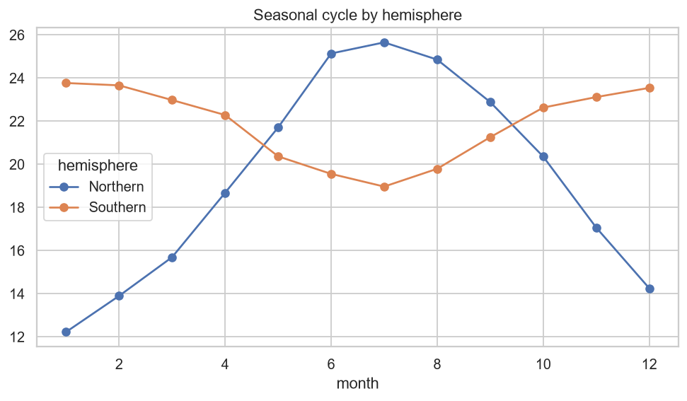
*Northern vs southern hemisphere seasonal cycle*

> **Insight:** Hottest country on average: Qatar (33.1 C); coldest: Iceland (5.6 C); highest mean precipitation: Sierra Leone (0.59 mm). Northern and southern hemisphere seasonal cycles are in opposite phase.
